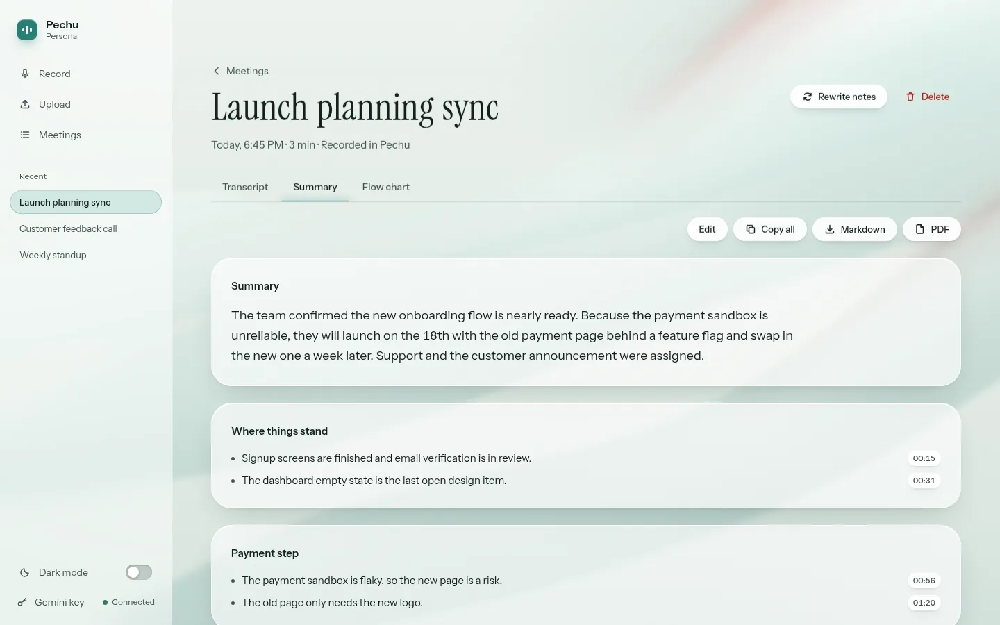
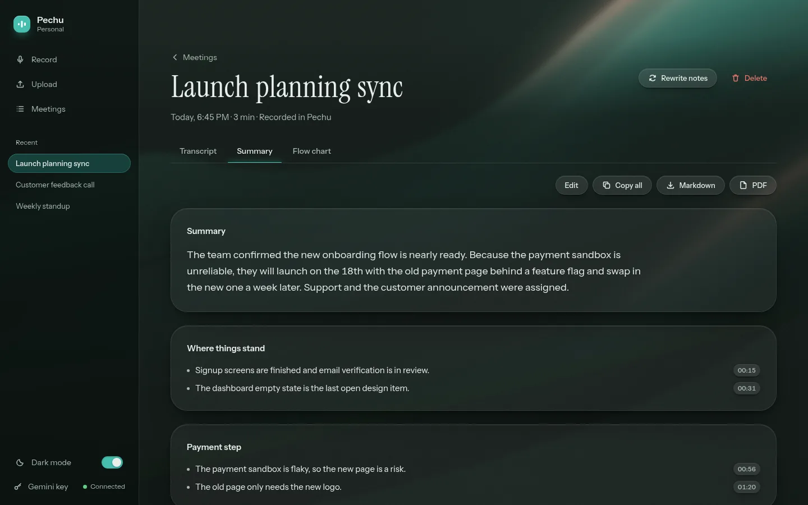
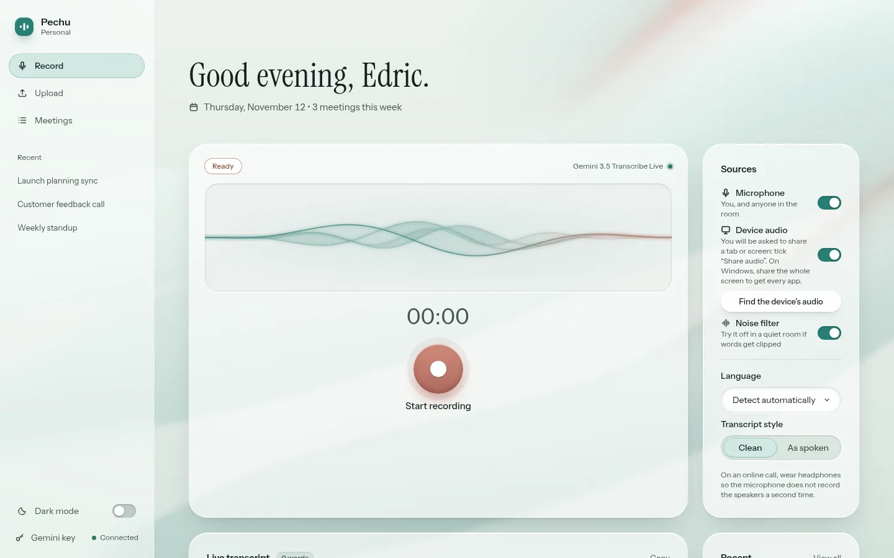
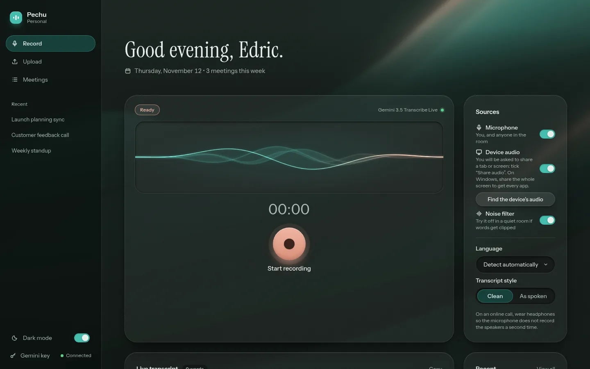
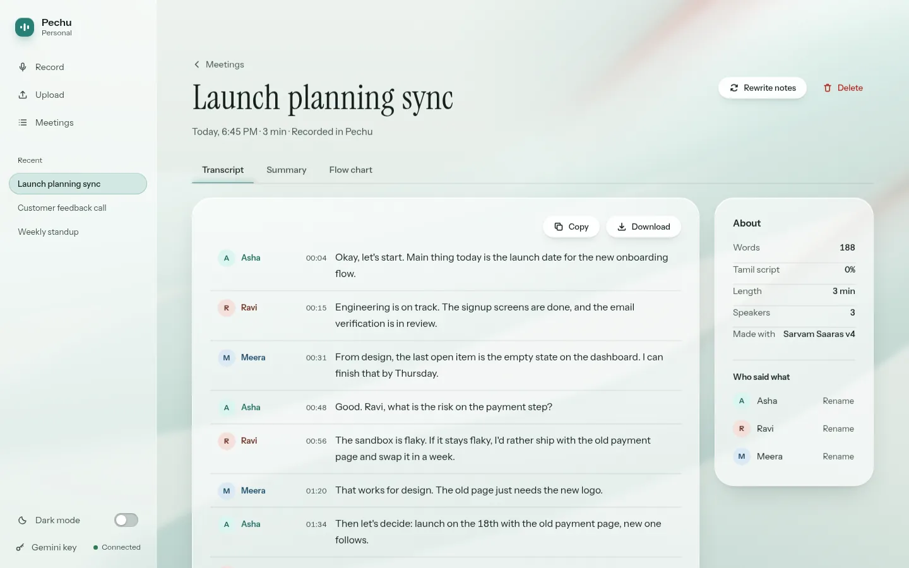
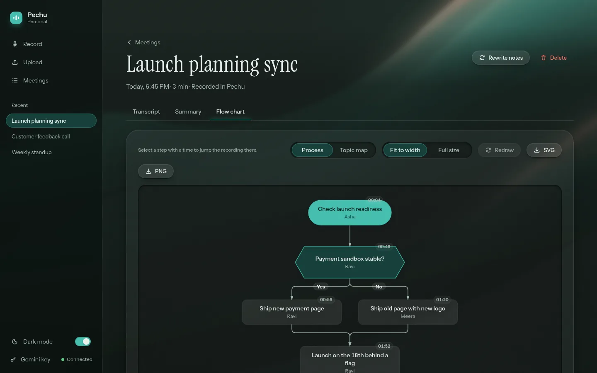
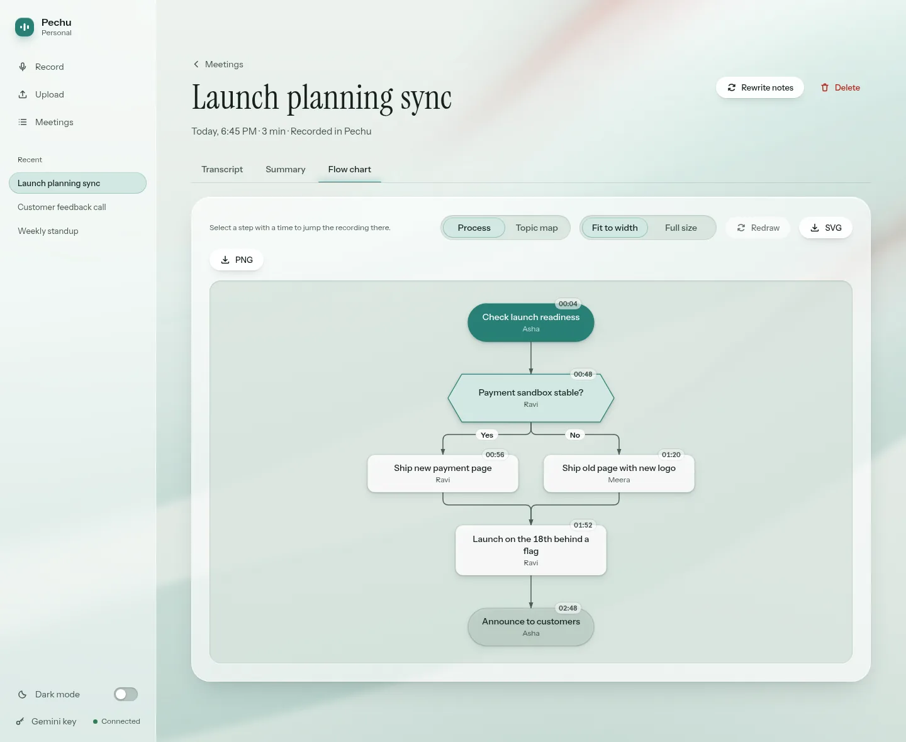
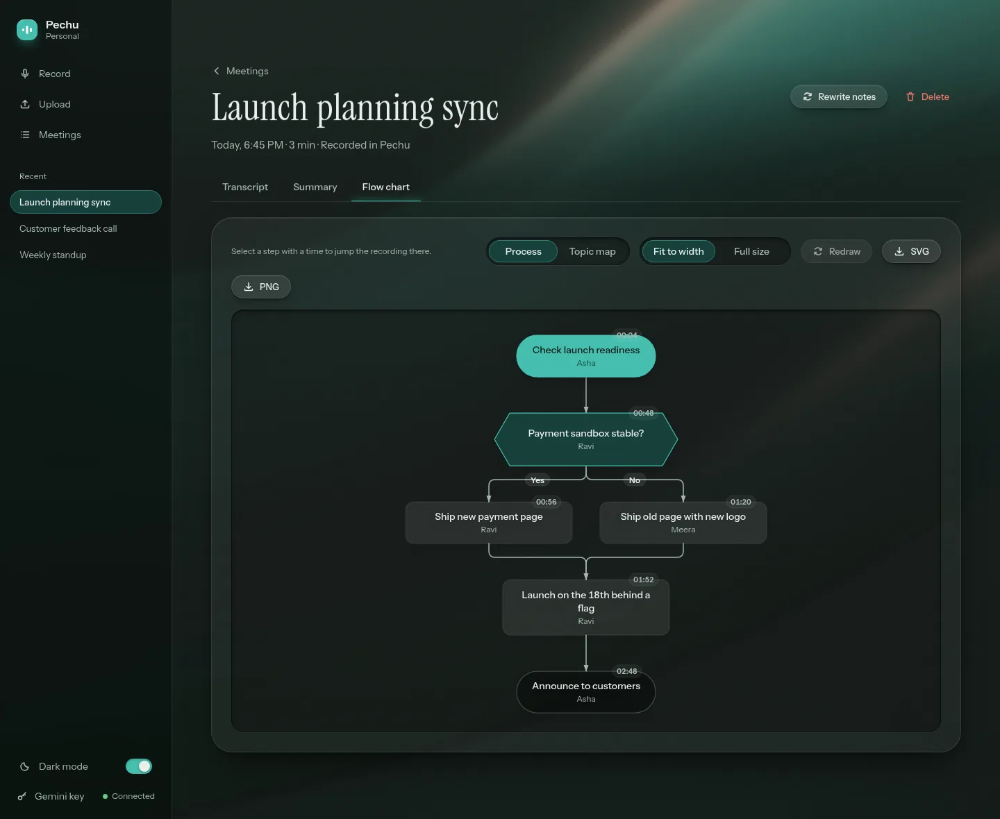

# Pechu

Record or upload a meeting and get a timed transcript, clear notes and a flow chart.
Pechu is built for people who speak Tamil mixed with English, and works for English too.

<p align="center">
  
  
</p>

## What it does

- **Record in the browser.** Use the microphone, the sound your computer plays (so the other people on a Zoom, Meet or Teams call are recorded too), or both. Live captions appear while you talk.
- **Or upload a file.** mp3, m4a, wav, ogg, opus, webm, aac, flac and mp4, up to 100 MB and 2 hours.
- **Improve a live transcript when you want to.** Live captions become the transcript. Press *Improve transcript* on the meeting and Sarvam listens to the saved recording again (about ₹0.49 a minute, ₹0.59 with speaker labels, before tax). The price is on the button, and nothing paid runs by itself.
- **A transcript you can read and click.** Each turn has a speaker and a time. Click a time to jump the audio there. Rename speakers once and every line updates.
- **Notes written for you.** A summary, sections, key points, decisions and action items with owners and due dates, plus an English version when the talk was in Tamil.
- **A flow chart of the meeting.** Pick a step-by-step process view or a topic map. Export it as SVG or PNG.
- **Take it with you.** Copy the notes, or download them as Markdown or PDF.
- **Light and dark mode.** It follows your system setting until you choose.
- **Your data stays in plain files.** Each meeting is a folder with a `meeting.json` and the audio. No database.

## Screenshots

The meetings in these screenshots are made up.

| | Light | Dark |
|---|---|---|
| **Record** |  |  |
| **Transcript** |  |  |
| **Notes** |  |  |
| **Flow chart** |  |  |

## How it works

```
 Browser (plain HTML/CSS/JS in public/)
    │  record / upload / read notes
    ▼
 Bun server (server/index.ts)
    ├── GStreamer ........ decodes audio (server/audio.ts)
    ├── Sarvam ........... transcription, best for Tamil mixed with English (server/sarvam.ts)
    ├── Gemini ........... notes, flow chart, English version, live captions (server/gemini.ts, server/live.ts)
    └── files on disk .... one folder per meeting (server/store.ts)
```

## Run it

You need [Bun](https://bun.sh), GStreamer, and a Gemini API key. A Sarvam key is optional.

```bash
# Ubuntu / Debian: audio decoding
sudo apt install gstreamer1.0-tools gstreamer1.0-plugins-base gstreamer1.0-plugins-good \
  gstreamer1.0-plugins-bad gstreamer1.0-libav

git clone https://github.com/Edric2412/Pechu.git
cd Pechu
bun install
cp .env.example .env     # then paste your keys into .env
bun run start            # then open http://localhost:4317
```

- `GEMINI_API_KEY` writes the notes and flow chart. Get one in [Google AI Studio](https://aistudio.google.com/). Without it the app sends you to the key page. You can also paste the key there instead of editing `.env`.
- `SARVAM_API_KEY` is optional. With it, Sarvam writes the transcript of uploads and the live captions, which works best for Tamil mixed with English. Sarvam charges per minute of audio, so a live recording is only listened to again when you press **Improve transcript** on the meeting.

`bun run dev` restarts the server when you edit a file.

## Run it with Docker

```bash
cp docker-compose.example.yml docker-compose.yml
# put your keys in .env.docker (see docs/OPERATIONS.md)
docker compose up -d
```

The container listens on `127.0.0.1:4317` only. If you want to reach it from other devices, put a TLS reverse proxy (Caddy, nginx or a Cloudflare Tunnel) in front and turn on a login. Pechu refuses to listen on a public address without one.

## Settings

The most useful ones. The full list is in [docs/OPERATIONS.md](docs/OPERATIONS.md).

| Variable | Default | What it does |
|---|---|---|
| `GEMINI_API_KEY` | none | Writes notes, flow charts and English versions. |
| `SARVAM_API_KEY` | none | Optional transcription service. |
| `PORT` | `4317` | Port to listen on. |
| `PECHU_DATA_DIR` | `./data/meetings` | Where meetings are stored. |
| `PECHU_PASSWORD`, `SESSION_SECRET` | none | Login, required if the server is reachable from other machines. |
| `RETENTION_DAYS` | keep forever | Delete meetings older than this many days. |
| `MAX_AUDIO_MINUTES` | `120` | Longest recording that is transcribed (a longer one is refused with a message). |

## Your data and your keys

- Meetings are stored on your machine. To transcribe, the audio is sent to Sarvam, or to Google when you have no Sarvam key. The transcript text goes to Google (Gemini) to write the notes. Live captions stream audio to the same services while you record. Check their terms before using Pechu for confidential meetings.
- API keys live in `.env` or `.env.docker`. Both are in `.gitignore`. Never commit them.
- Back up with `scripts/backup.sh` and restore with `scripts/restore.sh`.

## Develop

```bash
bun test      # 143 tests, about 2 seconds
```

- `server/` holds the Bun server, `public/` the screens, `tests/` the tests.
- Pull requests and pushes run the tests and a Docker build in GitHub Actions (`.github/workflows/ci.yml`).
- A security review was done on 2026-11-12. The findings and fixes are in [docs/SECURITY-AUDIT.md](docs/SECURITY-AUDIT.md).
- There is also a Cloudflare setup (`cloudflare-tunnel/` and `cloudflare/`) for putting Pechu behind Cloudflare Access.

## Limits

- One instance per data folder, no database, and no accounts: it is a personal tool.
- A transcription or notes job that is running when the server restarts has to be started again.
